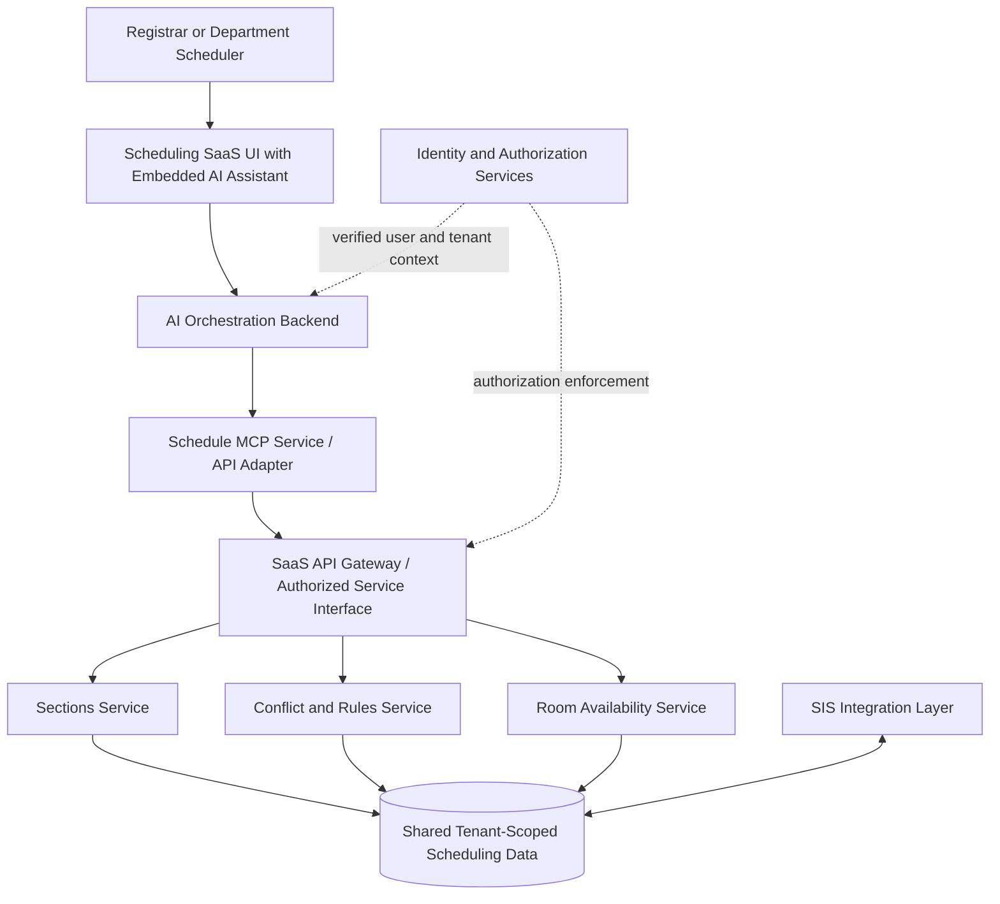

# Schedule MCP — Enterprise Architecture

> **Status:** Portfolio proof of concept with proposed production architecture  
> **Deployment scenario:** AI assistant embedded in a multi-tenant academic scheduling SaaS platform  
> **Scope:** Read-only scheduling discovery, conflict analysis, and room availability

## 1. Executive Overview

Schedule MCP demonstrates how an AI assistant can expose existing academic scheduling capabilities through the Model Context Protocol (MCP). Users ask natural-language questions about course sections, scheduling conflicts, and room availability. The assistant selects appropriate MCP tools, which retrieve scheduling facts and return structured results for explanation.

The proof of concept includes three working read-only MCP tools: `get_sections_by_term`, `get_schedule_conflicts`, and `find_available_rooms`. A separate integration simulation connects `get_schedule_conflicts` through an MCP adapter to a tenant-aware Scheduling API implemented locally in Python. Automated tests verify tenant-scoped retrieval, permission denial, and MCP error signaling; an interactive AI demonstration verifies the complete natural-language-to-API path.

### Product opportunity

Academic schedulers need timely answers across sections, rooms, instructors, and institutional scheduling rules. An embedded assistant could reduce navigation between reports and screens while preserving existing application workflows. The proposed design treats MCP as a secure interface to established SaaS services—not as a replacement for the application's scheduling engine.

### Implemented versus proposed

| Implemented and tested in the PoC | Proposed for production; not implemented |
| --- | --- |
| Three local read-only scheduling MCP tools | Embedded assistant in a hosted SaaS UI |
| Interactive AI tool selection and responses | Real user authentication and delegated authorization |
| Local MCP adapter calling a simulated Scheduling API function | Networked Scheduling APIs and service-to-service security |
| Tenant filtering with manually supplied test contexts | Database row-level security and verified tenant identity |
| Positive and permission-denied integration tests | Production observability, audit logging, resilience, and scaling |

## 2. System Architecture

The reference architecture places an AI assistant inside the scheduling application. The application's authenticated backend orchestrates model requests and MCP tool calls. The MCP service adapts those calls to existing SaaS APIs, which remain responsible for authorization, business rules, and tenant-scoped data access.



### Component responsibilities

| Component | Responsibility |
| --- | --- |
| Embedded assistant | Accept user questions and present grounded answers inside the scheduling UI. |
| AI orchestration backend | Call the model, select and execute approved tools, and handle tool responses. |
| Schedule MCP service | Publish tool schemas, validate tool inputs, adapt calls to SaaS APIs, and translate responses/errors. |
| SaaS API and scheduling services | Enforce permissions and tenant scope; retrieve sections; evaluate conflicts and room availability using authoritative business logic. |
| Shared data and SIS integration layer | Maintain tenant-scoped scheduling data and existing institutional integration workflows. |

### Architectural principles

- **Reuse business logic:** Conflict detection and room availability stay in the scheduling services, not in prompts or MCP adapters.
- **Preserve authorization:** The model supplies task arguments such as `term_id`, never authoritative user or tenant identity.
- **Read-only first:** The initial assistant retrieves and explains scheduling facts; it does not alter schedules or publish changes to an SIS.
- **Separate tenants:** Every request is scoped to a verified institution; the proposed shared database adds database-level isolation as defense in depth.
- **Design for change:** MCP contracts remain stable even if the underlying scheduling services evolve.

### Local demonstration versus production deployment

In the working simulation, `server_api_adapter.py` calls `scheduling_api.py` directly as a Python function. Its `DEMO_CONTEXT` is fixed to a test user at `university_a`. This is useful for validating the adapter boundary, but it is **not** authentication. In production, trusted services would verify the user's session, propagate appropriately scoped credentials, and enforce authorization at the SaaS API and data-access layers. The diagram describes this target architecture rather than the current local deployment.

---

*Next sections to add: Security and Tenant Isolation; MCP-to-SaaS Integration Contract; Error Handling and Observability; Test Evidence; Production Readiness Roadmap.*

---

## 3. Security and Tenant Isolation

### 3.1 Security Model

The production architecture uses defense-in-depth security. The embedded AI assistant operates within the authenticated SaaS application, while trusted backend services enforce user permissions and institutional data boundaries.

The AI model does not independently determine access privileges.

### 3.2 Authentication and Identity Propagation

1. The user authenticates through the SaaS application's existing identity or institutional SSO provider.
2. The SaaS backend validates the session and establishes the user's identity and active institution.
3. The AI orchestration service associates tool requests with verified execution context.
4. The MCP service validates delegated credentials before invoking scheduling APIs.
5. The Scheduling API independently enforces tenant scope and user authorization.

User identity, tenant identity, and permissions must originate from trusted authentication and authorization services, not model-generated tool arguments.

### 3.3 Role-Based Access Control

The proposed access model distinguishes between viewing and modifying scheduling information.

| Capability | Department Scheduler | Registrar |
|---|---|---|
| View sections across departments | Allowed, subject to institutional policy | Allowed |
| View institution-wide scheduling conflicts | Allowed, subject to institutional policy | Allowed |
| Edit sections in assigned departments | Allowed | Allowed, subject to permissions |
| Edit sections outside assigned departments | Denied | Subject to permissions |
| Access another institution's data | Denied | Denied |

Cross-department read-only visibility supports conflict resolution without granting unrestricted editing rights.

The initial Schedule MCP implementation remains entirely read-only.

### 3.4 Multi-Tenant Data Isolation

The reference architecture uses a shared database with tenant-scoped records.

Each tenant-owned scheduling record includes a tenant identifier. The Scheduling API derives tenant context from verified credentials and applies tenant-scoped authorization to every request.

For a PostgreSQL implementation, Row-Level Security (RLS) is proposed as an additional protection against accidental cross-tenant queries.

Production implementation must also address:

- Tenant-scoped record identifiers and relationships.
- Database roles that cannot bypass tenant isolation.
- Transaction-scoped tenant context for pooled connections.
- Tenant-aware caching and conversation history.
- Isolation of background jobs and asynchronous operations.
- Tenant-scoped logging and auditing.

### 3.5 MCP Security Boundaries

The MCP service acts as a controlled adapter between AI clients and existing SaaS services.

It must:

- Accept only validated tool arguments.
- Obtain tenant and user context from trusted services.
- Delegate authorization decisions to authoritative SaaS services.
- Avoid exposing credentials or internal infrastructure details.
- Prevent model instructions from overriding application security policies.
- Return only data authorized for the requesting user.

### 3.6 Auditability

Production tool executions should generate audit records containing:

- Request and correlation identifiers.
- Authenticated user and tenant identifiers.
- MCP tool name.
- Execution timestamp.
- Authorization outcome.
- Success or failure status.

Sensitive scheduling information and credentials should not be unnecessarily included in logs.

### 3.7 Prototype Implementation Status

The local proof of concept demonstrates tenant filtering and permission enforcement using simulated request contexts.

Automated tests verify that:

- University A receives only its own scheduling conflicts.
- University B receives only its own scheduling conflicts.
- Unauthorized users receive permission-denied errors.
- MCP tool failures are correctly reported using the protocol's error mechanism.

The prototype does not implement real SSO, delegated authentication, HTTP-based SaaS APIs, database Row-Level Security, or production audit infrastructure. These remain proposed production capabilities.

---

## 4. MCP-to-SaaS API Integration Contract

### 4.1 Integration Design

The Schedule MCP service acts as a thin adapter between AI clients and existing scheduling application services.

Its responsibilities include:

- Exposing scheduling capabilities as MCP tools.
- Validating tool arguments.
- Translating tool requests into SaaS API requests.
- Propagating verified authentication context.
- Normalizing successful responses.
- Translating application errors into MCP tool errors.

Scheduling business logic remains within the authoritative SaaS services.

The MCP service must not independently calculate scheduling conflicts, determine room availability, or override institutional scheduling rules.

### 4.2 MCP Tool Definition

**Tool:** `get_schedule_conflicts`

**Purpose:** Retrieve scheduling conflicts for an academic term.

**Operation:** Read-only.

**Required permission:** `schedule:read`.

**Input schema:**

```json
{
  "type": "object",
  "properties": {
    "term_id": {
      "type": "string",
      "description": "Academic term identifier"
    }
  },
  "required": ["term_id"],
  "additionalProperties": false
}

---

## 5. Testing and Validation

### 5.1 Testing Strategy

The Schedule MCP proof of concept uses multiple layers of testing to validate tool functionality, integration behavior, tenant isolation, and AI-driven execution.

Testing focuses on verifying that the MCP service correctly exposes scheduling capabilities while preserving the responsibilities of the underlying SaaS application.

### 5.2 Completed Tests

| Test | Validation | Result |
|---|---|---|
| MCP tool discovery | Client discovers scheduling tools | PASS |
| Section retrieval | Retrieves sections for Spring 2027 | PASS |
| Conflict detection | Returns two known scheduling conflicts | PASS |
| Room availability | Finds a room meeting requested constraints | PASS |
| AI tool selection | Model selects the appropriate MCP tool | PASS |
| AI tool execution | Selected tools execute successfully | PASS |
| Multi-tool request | AI executes multiple tools for one request | PASS |
| Tenant A isolation | University A receives only its conflicts | PASS |
| Tenant B isolation | University B receives only its conflicts | PASS |
| Permission enforcement | Unauthorized requests are rejected | PASS |
| MCP adapter integration | Adapter returns authorized scheduling data | PASS |
| MCP error propagation | Permission failures set `isError=True` | PASS |
| Unauthorized data protection | Error response excludes conflict data | PASS |
| Embedded-assistant simulation | AI retrieves conflicts through the adapter | PASS |

These results were observed during local development and testing.

### 5.3 Tenant Isolation Validation

The simulated Scheduling API contains conflict records belonging to two institutions.

Tests verify that the request context determines which institution's records are returned.

- University A receives two scheduling conflicts.
- University B receives one different scheduling conflict.
- Neither tenant receives the other tenant's records.

The tests demonstrate application-level filtering using simulated request contexts.

They do not establish production-grade authentication or database isolation.

### 5.4 Authorization Validation

A test user without `schedule:read` permission attempts to retrieve scheduling conflicts.

The Scheduling API rejects the request with `PERMISSION_DENIED`.

The MCP adapter propagates the failure as a tool execution error, and the response does not expose unauthorized conflict records.

This verifies the error-handling behavior of the simulated integration.

### 5.5 AI Integration Validation

The AI assistant successfully interprets natural-language scheduling requests, selects appropriate MCP tools, executes them, and incorporates tool results into user-facing responses.

A tested example:

**User request:**

> Show me all scheduling conflicts for Spring 2027.

**Observed behavior:**

1. The AI model selects `get_schedule_conflicts`.
2. It supplies `term_id` as `2027-SPRING`.
3. The MCP adapter invokes the simulated Scheduling API.
4. The API filters conflicts using the configured demo tenant context.
5. The AI assistant presents the two authorized conflicts.

The model does not receive University B's conflict records in this test.

### 5.6 Limitations of Current Testing

The proof of concept does not currently validate:

- Production SSO or session authentication.
- Cryptographically verified identity propagation.
- Real HTTP-based Scheduling API communication.
- PostgreSQL Row-Level Security.
- Department-level editing permissions.
- Production audit logging and monitoring.
- Load testing and concurrency behavior.
- Prompt-injection resistance under adversarial testing.
- Multi-round AI tool orchestration.
- Comprehensive failure handling across all tools.

These limitations are intentionally documented to distinguish demonstrated functionality from proposed enterprise capabilities.

### 5.7 Validation Summary

The proof of concept demonstrates the feasibility of using MCP as an integration layer between an AI assistant and academic scheduling services.

The completed tests support the following conclusions:

- AI models can discover and invoke scheduling capabilities through MCP.
- MCP tools can delegate scheduling operations to a separate application service.
- Tenant-aware application filtering can be demonstrated without duplicating scheduling business logic in the MCP adapter.
- Application authorization failures can be propagated through MCP.
- Natural-language requests can be translated into structured scheduling operations.

Production readiness would require the additional security, reliability, integration, and operational controls described in this document.

---

## 6. Production Roadmap

### 6.1 Objective

Evolve the Schedule MCP proof of concept into a secure, reliable, and maintainable AI integration for an enterprise academic scheduling SaaS platform.

The proposed production solution embeds an AI assistant within the existing scheduling application and uses MCP to expose authorized scheduling capabilities through established application services.

The roadmap prioritizes security and read-only functionality before introducing scheduling modifications or autonomous actions.

### 6.2 Phase 1: Secure Read-Only Integration

**Goal:** Replace simulated integrations with authenticated production services.

Key deliverables:

- Integrate with the SaaS application's existing authentication and authorization infrastructure.
- Establish verified user and tenant context.
- Implement secure service-to-service communication.
- Connect MCP tools to real Scheduling API endpoints.
- Enforce tenant isolation within application and database layers.
- Implement consistent authorization and error handling.
- Introduce audit logging and request tracing.

**Success criteria:**

- Authorized users can retrieve real scheduling information.
- Unauthorized requests are consistently rejected.
- Cross-tenant data exposure is prevented.
- Scheduling data is retrieved through existing authoritative services.

### 6.3 Phase 2: Operational Reliability

**Goal:** Make the integration suitable for controlled institutional deployment.

Key deliverables:

- Comprehensive integration and security testing.
- Request timeouts, retry policies, and rate limiting.
- Monitoring, alerting, and operational dashboards.
- Performance and concurrency testing.
- Prompt-injection and tool-abuse testing.
- Versioned MCP tool contracts.
- Tenant-aware caching and conversation management.

**Success criteria:**

- Service reliability meets agreed operational targets.
- Errors are observable and actionable.
- Tool execution remains within authorized boundaries.
- Changes to MCP contracts do not unexpectedly disrupt clients.

### 6.4 Phase 3: Expanded Scheduling Intelligence

**Goal:** Extend the assistant's usefulness beyond basic scheduling queries.

Potential capabilities:

- Explain scheduling conflicts and their contributing rules.
- Identify available rooms and alternative meeting times.
- Compare scheduling scenarios.
- Surface instructor workload concerns.
- Summarize room utilization.
- Identify scheduling patterns requiring registrar attention.

The scheduling application remains responsible for authoritative calculations and institutional business rules.

The AI assistant provides a conversational interface for accessing and interpreting those capabilities.

**Success criteria:**

- Users complete common scheduling analysis tasks more efficiently.
- AI-generated explanations remain grounded in authoritative scheduling data.
- Recommendations respect institutional rules and permissions.

### 6.5 Phase 4: Controlled Scheduling Actions

**Goal:** Evaluate carefully governed write operations after read-only capabilities are proven.

Potential capabilities:

- Propose section meeting-time changes.
- Recommend room reassignment.
- Prepare scheduling adjustments for review.
- Submit approved changes through existing scheduling workflows.

Required safeguards:

- Department-scoped write permissions.
- Explicit user confirmation for consequential changes.
- Validation against authoritative scheduling rules.
- Existing approval and workflow enforcement.
- Transactional consistency and concurrency controls.
- Complete audit history.
- Clear recovery procedures for failed operations.

The AI assistant must not bypass established application permissions, scheduling policies, or approval workflows.

**Success criteria:**

- Authorized users can initiate supported changes safely.
- Every modification is validated by existing application services.
- Approval and audit requirements remain intact.

### 6.6 Product and Business Outcomes

Potential measures of success include:

| Outcome | Example Metric |
|---|---|
| Improved scheduler efficiency | Time required to investigate conflicts |
| Reduced operational overhead | Manual steps per scheduling task |
| Increased feature accessibility | Adoption of conversational scheduling workflows |
| Improved scheduling quality | Conflicts identified before schedule publication |
| Stronger platform extensibility | Reuse of scheduling APIs across interfaces |
| Operational reliability | Tool success rate and response latency |

These are proposed measurement areas, not measured outcomes of the current proof of concept.

### 6.7 Architectural Principles

The production roadmap follows five principles:

1. **Security first:** Authentication, authorization, and tenant isolation remain authoritative.
2. **Reuse existing services:** MCP exposes established capabilities rather than duplicating business logic.
3. **Start read-only:** Demonstrate value before enabling modifications.
4. **Maintain human oversight:** Consequential scheduling actions require appropriate authorization and approval.
5. **Measure outcomes:** Evaluate improvements in scheduling efficiency, quality, and user adoption.

### 6.8 Conclusion

The Schedule MCP proof of concept demonstrates how an AI assistant can interact with academic scheduling capabilities through a standardized tool interface.

Its value extends beyond conversational AI. The architecture illustrates how existing SaaS platforms can expose established business capabilities to AI systems while retaining control over authorization, tenant boundaries, and business rules.

The completed prototype validates the fundamental integration approach. The proposed roadmap identifies the additional capabilities necessary to move toward a secure, production-ready enterprise implementation.
