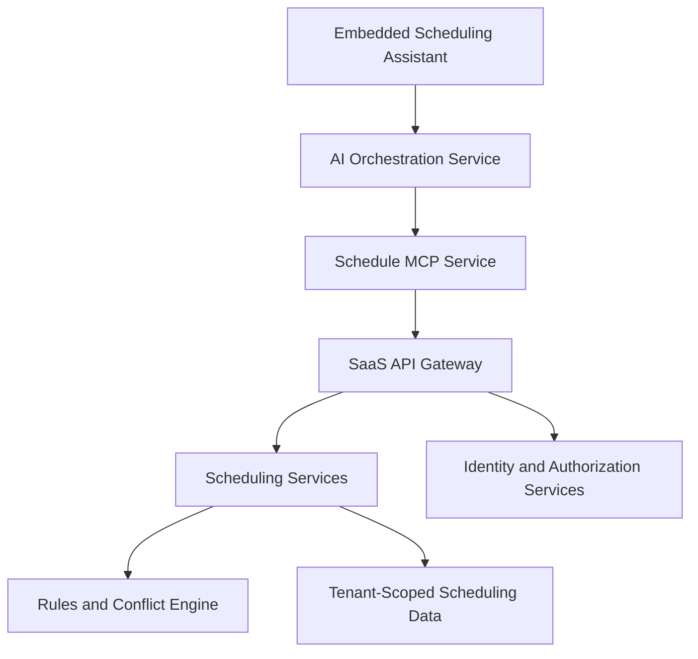

# Schedule MCP — Enterprise AI Integration Proof of Concept

A working proof of concept demonstrating how an AI assistant can interact with an academic scheduling SaaS platform using the Model Context Protocol (MCP).

The project combines natural-language AI interaction, read-only scheduling tools, a simulated multi-tenant SaaS API, and authorization-aware integration design.

> **Project status:** Functional local prototype. Uses simulated academic scheduling data and security contexts; not a production deployment.

## The Business Problem

Academic scheduling involves complex institutional rules, shared resources, instructor availability, and integrations with Student Information Systems (SIS).

Schedulers often need to navigate multiple application screens to investigate conflicts, locate available rooms, or review academic sections.

An embedded AI assistant could simplify these workflows by providing conversational access to existing scheduling capabilities.

The challenge is integrating AI without bypassing institutional permissions, duplicating application business logic, or exposing another institution's data.

## The Solution

This proof of concept uses MCP as a standardized interface between an AI assistant and academic scheduling capabilities.

The architecture follows a key principle:

**The AI assistant provides the conversational interface; existing SaaS services remain responsible for business rules, authorization, and authoritative scheduling data.**

The prototype demonstrates:

- MCP tool discovery and execution.
- Natural-language tool selection using the OpenAI API.
- Read-only scheduling queries.
- Multiple tool calls within a single user request.
- A simulated tenant-aware Scheduling API.
- Permission enforcement and MCP error propagation.
- Automated integration and authorization tests.

## Architecture

The proposed production architecture embeds an AI assistant within the scheduling SaaS application.



The working prototype simulates the SaaS API through local Python functions rather than implementing the full production infrastructure.

See [ARCHITECTURE.md](ARCHITECTURE.md) for the security model, integration contracts, testing evidence, and production roadmap.

## MCP Tools

The original read-only MCP server exposes three tools:

| Tool | Purpose |
|---|---|
| `get_sections_by_term` | Retrieve academic sections for a term |
| `get_schedule_conflicts` | Identify room and instructor scheduling conflicts |
| `find_available_rooms` | Find rooms matching time and capacity requirements |

The separate SaaS API adapter currently implements `get_schedule_conflicts` to demonstrate tenant-aware service integration.

## Example Interactions

The interactive assistant supports requests such as:

- "Show me the sections for Spring 2027."
- "Are there any scheduling conflicts for Spring 2027?"
- "Find an available room on Monday from 9:30 to 10:30 for 30 students."
- "Show me the sections and conflicts for Spring 2027."

The API adapter demonstration supports conflict queries using the simulated University A context.

## Technology Stack

- Python 3.10+ (developed and tested using Python 3.13)
- MCP Python SDK 1.x
- OpenAI Python SDK 3.x
- OpenAI Responses API
- Python unittest
- MCP Inspector
- Simulated academic scheduling and multi-tenant SaaS services

## Installation

Clone the repository and navigate to the project directory.

Create and activate a virtual environment:

```bash
python3 -m venv .venv
source .venv/bin/activate
```

Install dependencies:

```bash
python -m pip install -r requirements.txt
```

For Windows, use the appropriate virtual environment activation command.

## Running the MCP Server

The original MCP server uses standard input/output transport:

```bash
python server.py
```

This is not an HTTP web server. It communicates with MCP clients through protocol messages over standard input and output.

To inspect its tools using Node.js and MCP Inspector:

```bash
npx @modelcontextprotocol/inspector python server.py
```

## Running the AI Assistant

The AI integration requires an OpenAI API key with available API credits.

Set the key in your terminal session:

```bash
export OPENAI_API_KEY="your-api-key"
```

Do not commit API keys to source control.

Start the interactive assistant:

```bash
python interactive_assistant.py
```

To run the tenant-aware API adapter demonstration:

```bash
python interactive_api_demo.py
```

The AI examples use an OpenAI model and incur API usage charges.

## Testing

Run the local scheduling and MCP integration tests:

```bash
python -m unittest test_logic.py
python test_mcp_integration.py
```

Run the simulated SaaS API and MCP adapter tests:

```bash
python -m unittest test_scheduling_api.py
python test_api_adapter.py
python test_adapter_errors.py
```

Additional AI integration tests are available:

- `test_openai.py`
- `test_tool_selection.py`
- `test_ai_execution.py`

These tests may require API credentials and incur API usage charges.

## Security Design

The proposed production architecture uses trusted user and tenant context established by the SaaS application's authentication services.

The MCP service acts as a thin API adapter and does not independently grant access to institutional data.

The current simulation demonstrates:

- Tenant-scoped conflict retrieval.
- Permission checks using `schedule:read`.
- Rejection of unauthorized requests.
- MCP error propagation without exposing unauthorized conflict data.

The simulation uses hardcoded or manually constructed request contexts. It does not implement real SSO, delegated credentials, database Row-Level Security, or production audit infrastructure.

## Project Structure

| File | Responsibility |
|---|---|
| `server.py` | Original three-tool MCP server |
| `client.py` | MCP client integration |
| `interactive_assistant.py` | Natural-language scheduling assistant |
| `schedule_assistant.py` | AI scheduling integration |
| `scheduling_api.py` | Simulated tenant-aware SaaS API |
| `server_api_adapter.py` | MCP-to-SaaS API adapter |
| `interactive_api_demo.py` | AI demonstration using the API adapter |
| `server_api_adapter_unauthorized.py` | Unauthorized test fixture |
| `test_*.py` | Functional, integration, and authorization tests |
| `ARCHITECTURE.md` | Enterprise architecture case study |

## Limitations

This is a local proof of concept, not a production-ready integration.

Current limitations include simulated data, simplified scheduling rules, no persistent database, no real authentication, and no production HTTP API.

The AI assistant supports multiple tool calls within a response but does not yet implement robust multi-round orchestration or comprehensive error recovery.

## Future Development

The proposed roadmap includes:

1. Integration with real scheduling APIs and trusted identity services.
2. Production authorization, tenant isolation, monitoring, and reliability controls.
3. Expanded scheduling analysis and recommendations.
4. Controlled write operations with explicit authorization and human approval.

See [ARCHITECTURE.md](ARCHITECTURE.md) for detailed design decisions and roadmap.

## Project Purpose

This project explores how existing enterprise SaaS capabilities can be exposed to AI systems through MCP while preserving the application's responsibility for security, business logic, and data integrity.

It demonstrates a practical approach to integrating AI into established software platforms rather than building a disconnected AI experience.
